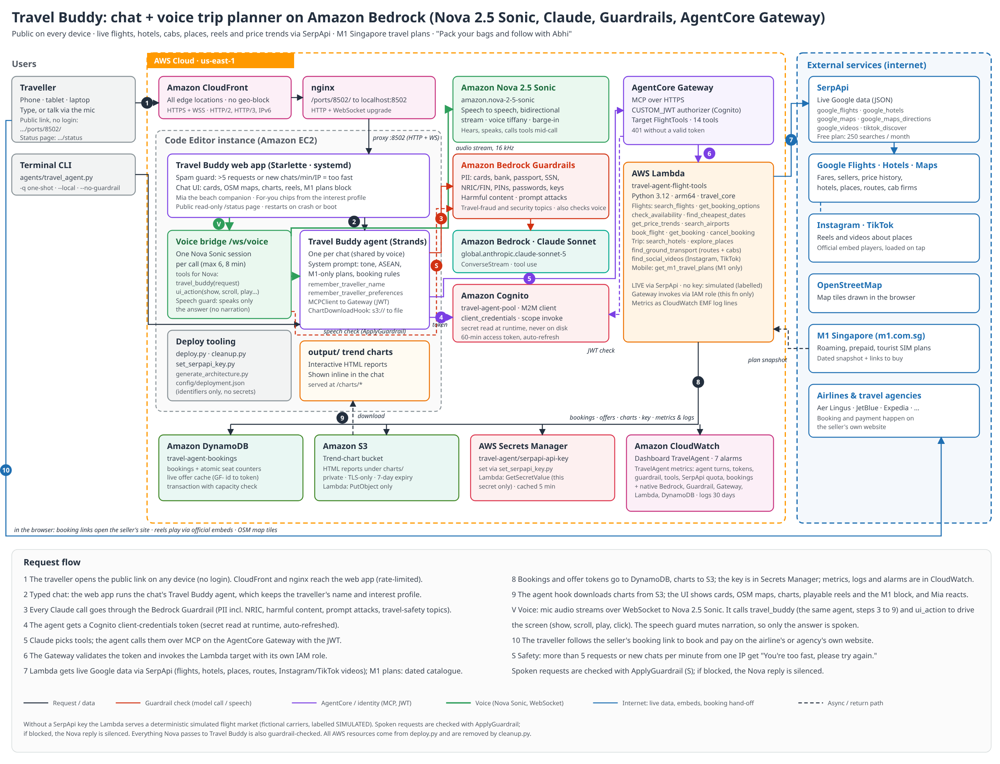
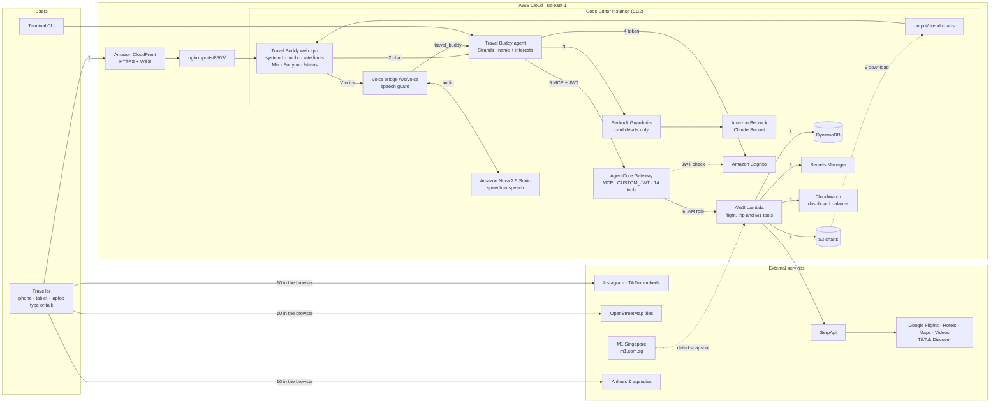

# Travel Buddy architecture

Files:
- `architecture.svg`: editable vector source (opens in a browser and imports into draw.io, PowerPoint or Figma)
- `architecture.png`: high-resolution export for slides and docs
- `generate_architecture.py`: regenerates the SVG (`python docs/generate_architecture.py`)
- The Mermaid version below renders directly on GitHub

## Components

| Layer | Services | Purpose |
|---|---|---|
| Users | Browser on phone, tablet or laptop (type or talk); terminal CLI | Plan trips by chat or voice: flights, hotels, cabs, places, reels, price trends, M1 mobile plans |
| Edge | Amazon CloudFront (all edge locations, HTTPS + WSS, IPv6), nginx `/ports/8502/` (HTTP + WebSocket) | Public worldwide access to the web app on the Code Editor instance |
| App | Starlette web app as the `travel-buddy` systemd service | Public (no login) with per-visitor and daily rate limits; chat UI with cards, OSM maps, charts, reels and the M1 block; Mia the companion; personalised "For you" chips; public read-only `/status` |
| Voice | Voice bridge `/ws/voice` ↔ **Amazon Nova 2.5 Sonic** (bidirectional speech-to-speech) | Nova listens and speaks. It calls `travel_buddy` (the same agent as the chat) and `ui_action` (drives the screen). A speech guard speaks only the answer |
| Agent | Strands Agents SDK, one Travel Buddy agent per chat | Tone, ASEAN focus, M1-only mobile plans, booking rules; remembers the traveller's name and interest profile |
| Model & safety | Amazon Bedrock (Claude Sonnet), **Amazon Bedrock Guardrails**, spam guard | Reasoning and tool use. The guardrail blocks PII (cards, bank, passport/SSN/NRIC, PINs, passwords, keys), harmful content and prompt attacks. More than 5 requests or new chats per minute from one IP get "You're too fast, please try again." |
| Identity | Amazon Cognito (client credentials) | JWT for the Gateway; secret read at runtime, never stored on disk |
| Tools | **Amazon Bedrock AgentCore Gateway** (MCP, CUSTOM_JWT) → AWS Lambda | 14 tools: flights, bookings, hotels, places, transport and cabs, Instagram/TikTok videos, price trends, M1 plans |
| Data | DynamoDB, S3, Secrets Manager, CloudWatch | Bookings and offer cache, trend reports, SerpApi key, metrics, dashboard, alarms, logs |
| External | SerpApi (Google Flights, Hotels, Maps, Directions, Videos; TikTok Discover), Instagram and TikTok embeds, OpenStreetMap tiles, M1 Singapore, airlines and agencies | Live data; reels and maps load in the browser; booking and payment happen on the seller's site |

## Mermaid version

## Request flow

1. The traveller opens the public link on any device (no login). CloudFront and nginx reach the web app, which is rate-limited.
2. **Typed chat:** the web app runs the chat's Travel Buddy agent, which keeps the traveller's name and interest profile.
3. Every Claude call goes through the Bedrock Guardrail (PII, harmful content, prompt attacks, travel-safety topics). More than 5 requests or new chats per minute from one IP are refused with "You're too fast, please try again."
4. The agent gets a Cognito client-credentials token (secret read at runtime, auto-refreshed).
5. Claude picks tools; the agent calls them over MCP on the AgentCore Gateway with the JWT.
6. The Gateway validates the token and invokes the Lambda target with its own IAM role.
7. Lambda gets live Google data via SerpApi (flights, hotels, places, routes, Instagram and TikTok videos). M1 plans come from a dated catalogue built from m1.com.sg.
8. Bookings and offer tokens go to DynamoDB, charts to S3; the SerpApi key is in Secrets Manager; metrics, logs and alarms are in CloudWatch.
9. The agent hook downloads charts from S3. The UI shows cards, OSM maps, charts, playable reels and the M1 block, and Mia reacts.
10. The traveller follows the seller's booking link to book and pay on the airline's or agency's own website.

**V. Voice.** Mic audio (16 kHz PCM) streams over a WebSocket to **Nova 2.5 Sonic**:
- It calls `travel_buddy`, which goes to the same agent (steps 3 to 9), so results render in the chat.
- It calls `ui_action` to drive the screen (show, scroll, play, click).
- The speech guard mutes narration and next-step offers, so only the answer is spoken.
- What the traveller says is checked with `ApplyGuardrail`; if it's blocked, Nova's reply is silenced and the guardrail message is shown. Everything Nova passes to Travel Buddy is also guardrail-checked.
